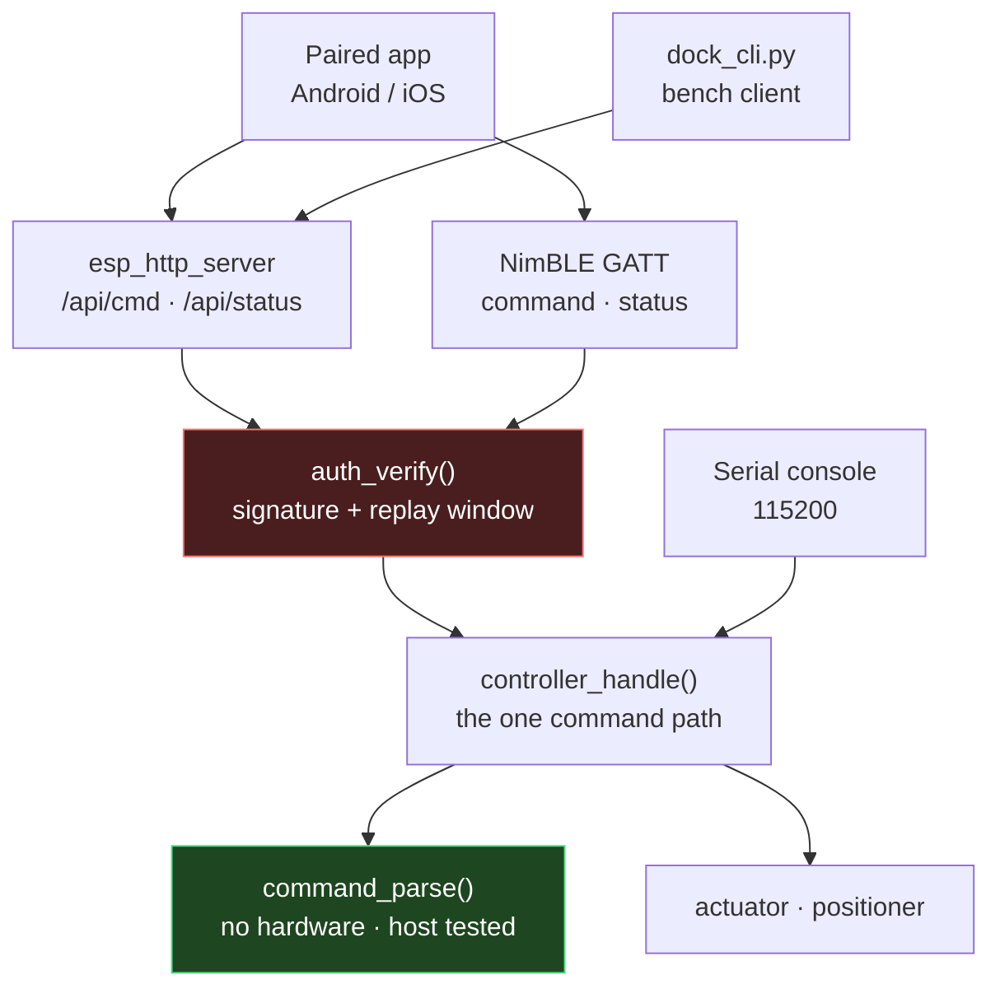
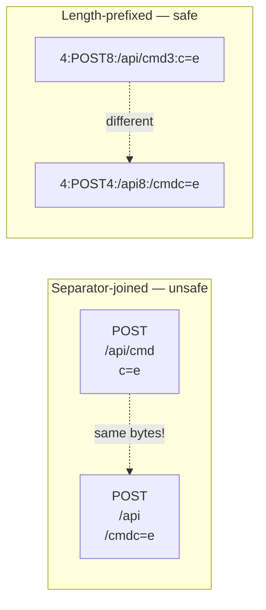
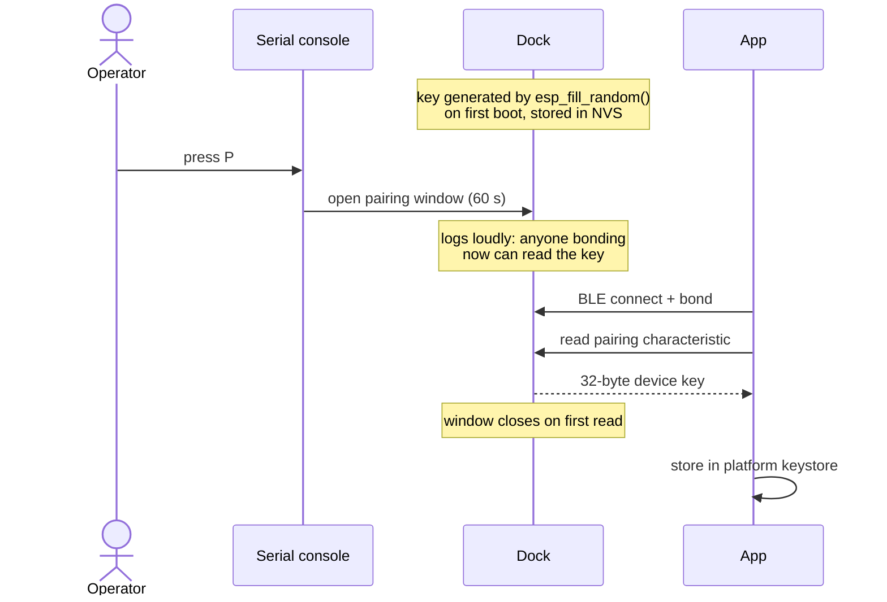
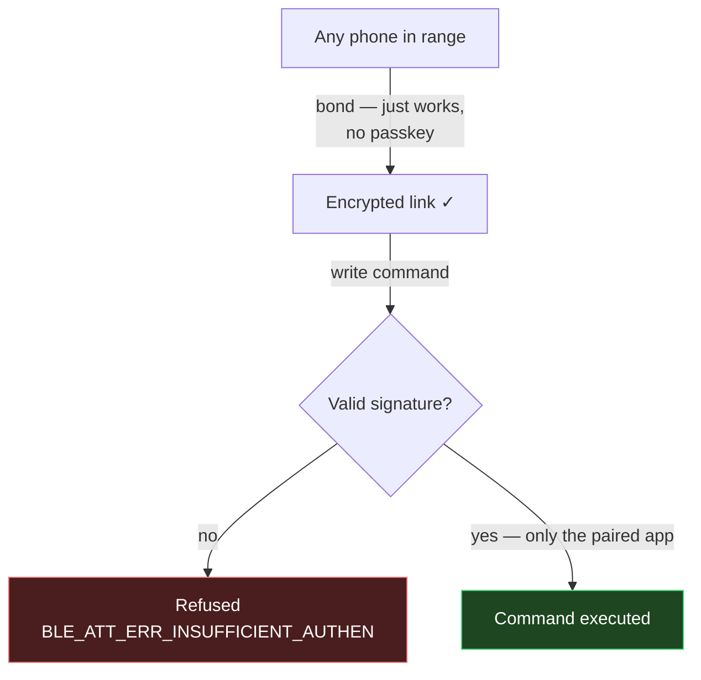
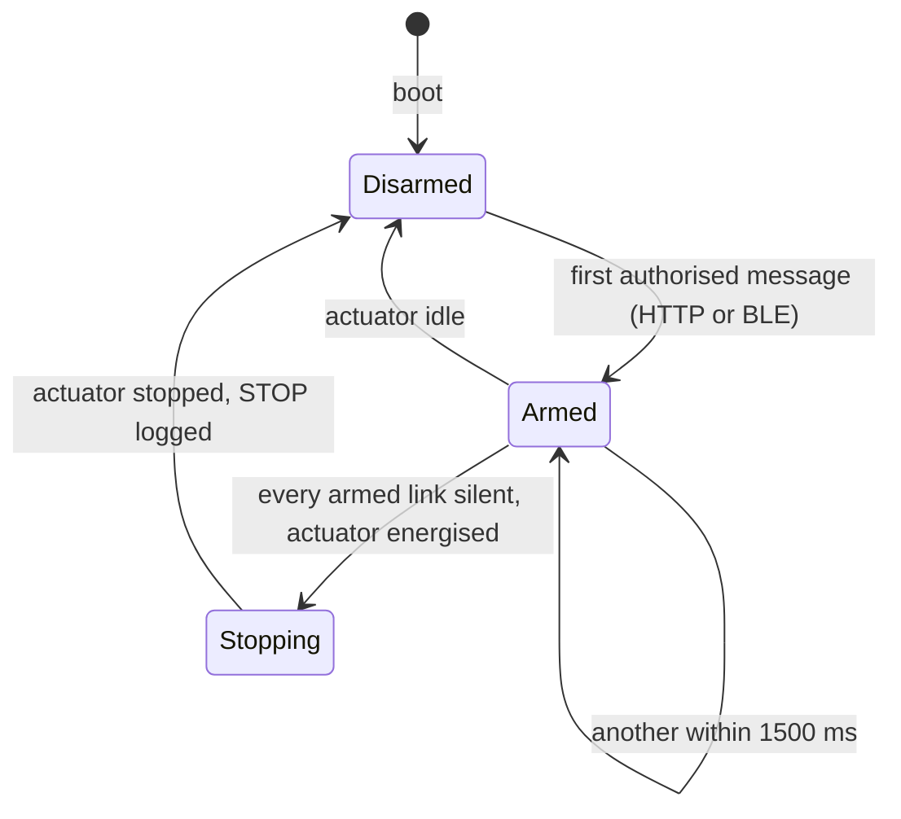
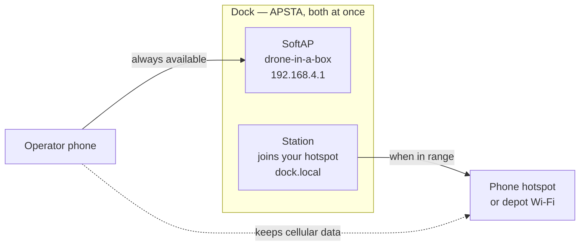

# Control interface

How an operator reaches the dock, how the dock decides whether to obey, and
where that goes in production.

> **One sentence:** the dock exposes the same command set over Wi-Fi and BLE,
> every command must be signed with a key that only the paired app holds, and
> the firmware stops the actuator by itself if the client goes quiet.

## 1. Two transports, one command path



Serial bypasses the gate on purpose: it needs physical access to the board,
which the spec places out of scope, and a technician must not be locked out of
a dock whose key they do not have.

## 2. Why signing, not HTTPS

TLS on the ESP32 was considered and rejected:

| | TLS | Signed requests |
| --- | --- | --- |
| Flash cost | mbedTLS + certificates | a few KB |
| Handshake | slow on the S3 | none |
| Browser | self-signed cert rejected anyway | n/a |
| Replay protection | not by itself | built in |

It would have been the most expensive option that still failed the case it was
meant to fix. Since only the paired app may control the dock, **authenticity
and replay protection are what is actually needed** — and the browser
compatibility problem dissolves, because the browser is no longer the control
path.

### What a request carries

```
X-Dock-Nonce: 1734
X-Dock-Sig:   <base64 HMAC-SHA256 of the canonical form>
```

The canonical form is **length-prefixed**, not separator-joined:

```
4:POST8:/api/cmd3:c=e4:1734
```



With separators, a signature captured for one request would authorise a
different one. BLE writes sign the payload **as bytes**, because credentials
are `ssid\0password` and a `strlen`-based form would leave the password
unsigned.

## 3. Pairing: how the app gets the key



**The window is opened from the serial console, never remotely** — an
authorised HTTP `P` is refused with *"pairing is opened from the serial console
only"*. Opening it over the network would let an attacker create their own way
in.

## 4. Link encryption is not authorisation

The single most important thing to understand about the BLE side:



The dock has no display or keypad, so pairing is **"just works"** — encrypted
and bonded, but not authenticated. Any device in range can bond. `WRITE_ENC`
therefore means *any bonded device*, not *my app*, and the signature is what
actually enforces FR1 on BLE.

## 5. The dead-man switch



Lives in `session/`, shared by both transports. **Only an authorised message
pets it** — a 401 must not count as liveness, or a stranger could hold it open
after the operator left. Serial never arms it: a cable means someone is
physically present.

## 6. Networking



The SoftAP is **unconditional**. Station mode is strictly additive, so losing
the hotspot can never make the dock unreachable — that is FR12, and it is why
there is no "fallback" mode to switch into. Joining the operator's hotspot is
the useful case: the dock gets a network and the phone keeps its internet.

## 7. Status

| Capability | State |
| --- | --- |
| Signed HTTP control | built, host tested, **not yet run on hardware** |
| Replay protection | built, host tested, **not yet run on hardware** |
| APSTA + mDNS | built, **not yet run on hardware** |
| BLE pairing + provisioning | built, **not yet run on hardware** |
| BLE signed control | built, **not yet run on hardware** |
| KMP client | written, **never compiled** |
| Physical E-stop | **not built** — and it is the actual safety mechanism |
| OTA, cloud, fleet | out of scope |

## Known limitations

- **Pairing is "just works".** An attacker in range *during the 60 s window*
  could man-in-the-middle it. Mitigated by the window being short,
  operator-opened and one-shot; not eliminated.
- **The SoftAP password is a compile-time constant in git**, so every dock
  built from this repository shares it. See the validation finding in
  `specs/001-secure-control-interface/spec.md`.
- **`K` prints the device key over serial.** Deliberate, physical-access-only,
  and superseded by the pairing window.
- **No physical E-stop.** Every stop in this document is a software stop. The
  wired E-stop that cuts actuator power is still a design-document item, and it
  is what should be relied on.
- **No rate limiting** on failed authorisation attempts — they are logged, not
  throttled.
