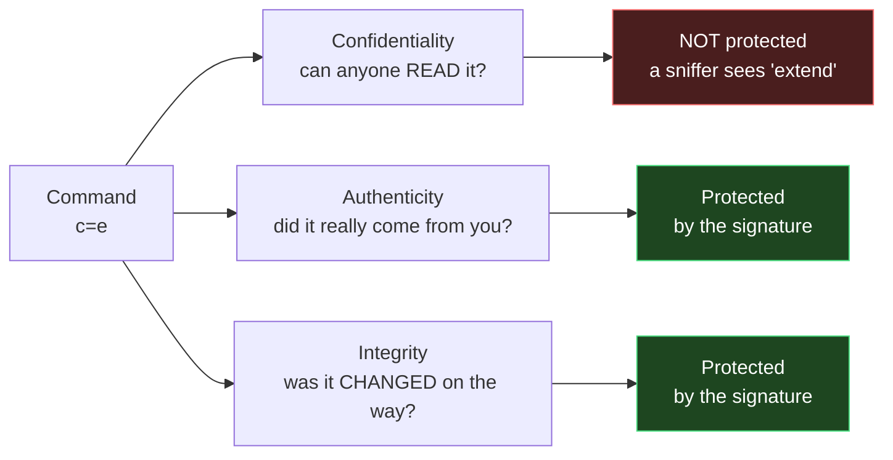
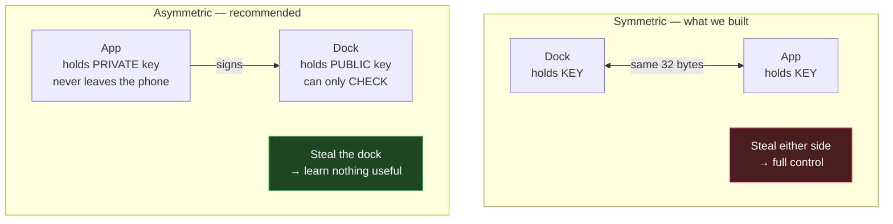
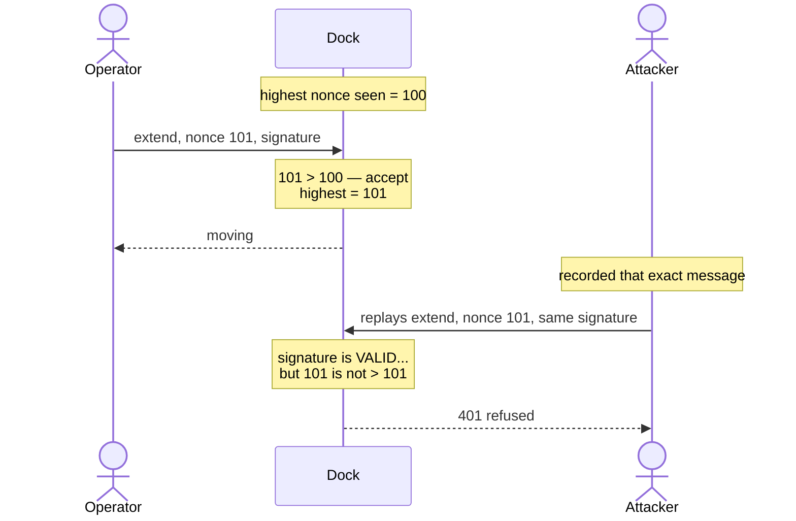
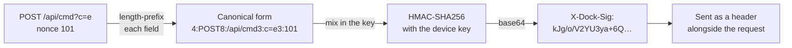
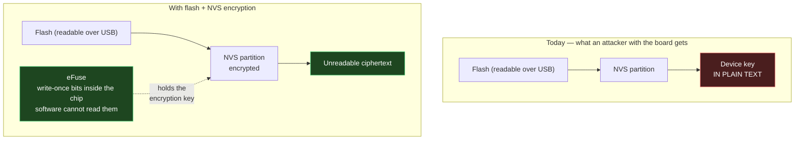
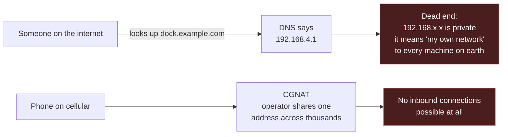
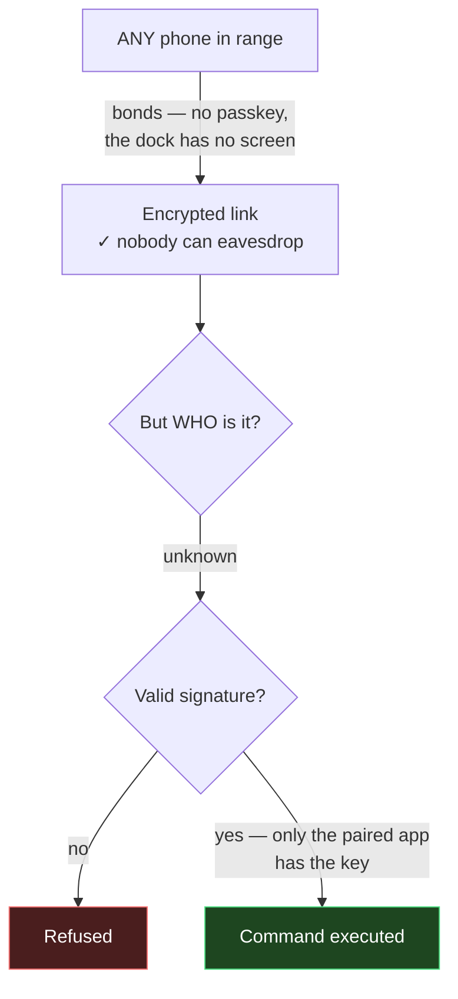
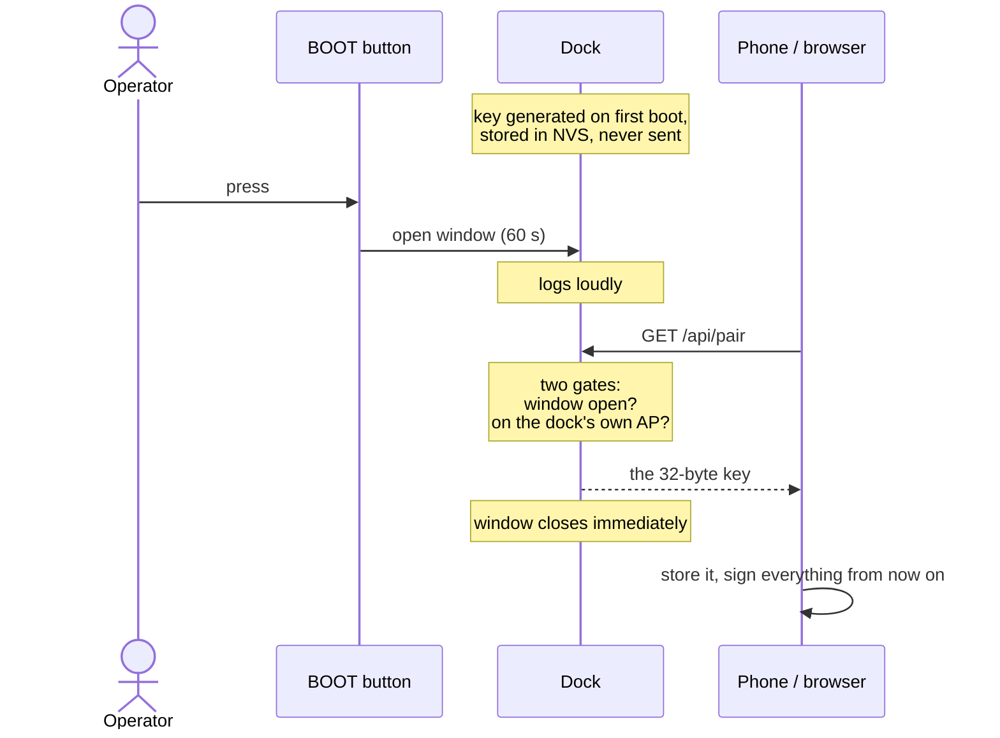

# Glossary

Every technical term used in the security and architecture discussions for this
project, in plain language, with a note on where it actually appears in our
work. Written to be read top to bottom the first time — later sections build on
earlier ones.

---

## 1. What "security" actually means

Three separate things. Most confusion comes from mixing them up.

**Confidentiality** — nobody else can *read* the message.
Example: your Wi-Fi password should be unreadable in transit.

**Authenticity** — the message really came from who it claims.
Example: this "extend the lift" command really came from the operator's app.

**Integrity** — the message wasn't *changed* on the way.
Example: nobody turned `c=s` (stop) into `c=e` (extend) in flight.

> **Our system has authenticity and integrity, but not confidentiality.** Commands
> are signed, not encrypted — anyone sniffing the Wi-Fi can *read* that you sent
> "extend", but cannot *send* one themselves or alter yours. For a lift command
> that is a reasonable trade; for a Wi-Fi password it is not, which is why BLE
> provisioning uses an encrypted link.

---

## 2. Keys, secrets and the two families

**Key** — a secret number used by a cryptographic algorithm. Ours is 32 random
bytes, which we show as 64 hexadecimal characters.

**Hexadecimal (hex)** — counting in base 16, digits `0-9` then `a-f`. Each pair
of hex characters is one byte, so 32 bytes prints as 64 characters. It is just a
readable way to write binary, not a form of encoding or protection.

**Symmetric cryptography** — *one shared key*, held by both sides. Fast and
simple. The weakness: both sides hold the same secret, so a copy taken from
either side gives full power to an attacker, and you cannot tell the two sides
apart.
→ *This is what we built.* The dock and the app hold the same 32 bytes.

**Asymmetric cryptography** (also "public-key") — a *key pair*. A **private
key** that never leaves its owner, and a **public key** that can be handed out
freely. What one signs, the other verifies.
→ *This is what I recommended for production.* The app keeps the private key in
the phone's secure storage; the dock only ever holds the public key, which is
useless for forging commands.

**Why asymmetric is better here:** stealing the dock gives you nothing. You can
also enroll several phones, each with its own key, and revoke one without
touching the others.

---

## 3. Hashing and signing

**Hash function** — turns any amount of data into a fixed-size fingerprint.
Same input always gives the same fingerprint; changing one bit changes the
fingerprint completely; and you cannot work backwards from the fingerprint to
the data.

**SHA-256** — the specific hash function we use. "256" is the output size in
bits (32 bytes). It is an industry standard, not something we invented.

**HMAC** (Hash-based Message Authentication Code) — a hash *with a key mixed
in*. A plain hash proves the data wasn't corrupted; anyone could recompute it.
An HMAC proves the data came from someone holding the key, because only they
could produce a matching value.
→ Our `X-Dock-Sig` header is an HMAC-SHA256.

**Signature** — in general, proof that a message came from a specific holder of
a key. With symmetric crypto this is an HMAC; with asymmetric it is a true
digital signature (Ed25519, ECDSA).

**Ed25519** — a modern asymmetric signature algorithm. Fast, small keys (32
bytes), small signatures (64 bytes), and hard to implement wrongly. The usual
recommendation for new designs.

**ECDSA** — an older asymmetric signature algorithm, widely supported but
easier to get subtly wrong. Ed25519 is generally preferred for new work.

**Constant-time comparison** — comparing two secrets in a way that always takes
the same amount of time, no matter where they first differ. A normal comparison
stops at the first mismatching byte, and an attacker who can measure the timing
can discover a secret one byte at a time. Our `auth_equal_ct()` does this, and
it is why it has no early exit.

---

## 4. Attacks, and what defends against them

**Replay attack** — an attacker records a valid message and sends it again
later. The signature is perfectly valid, because it *is* your message. Without a
defence, recording one "extend" command lets them extend the lift whenever they
like.

**Nonce** — "number used once". A counter included in every message and in the
signature. The dock remembers the highest it has accepted and refuses anything
equal or lower, so a recorded message can never be reused.
→ This is why our dock tracks a "high-water mark", and why `/api/nonce` exists:
a freshly installed app needs to know where to start counting.

How a replay attack works, and what the nonce does about it:

**Man-in-the-middle (MITM)** — an attacker sits between two parties, relaying
and possibly altering messages while both believe they are talking directly.
Signatures stop alteration; only encryption stops reading.

**Brute force** — simply trying every possibility. A 32-byte key has more
combinations than there are atoms in the observable universe, so guessing it is
not a realistic attack. Guessing a 4-digit PIN is.

**Rate limiting** — refusing to answer more than N attempts per period, to make
guessing impractical. We log failed attempts but do not throttle them; that gap
is recorded as task T22.

**Threat model** — the explicit list of *who* you are defending against and
*what* they can do. Without one, "is this secure?" has no answer. Ours: someone
in radio range, or on the same network, who does not have physical access to the
dock.

---

## 5. Key exchange, sessions and encryption

How one command gets signed, end to end:

The dock repeats these exact steps with its own copy of the key. If its result
matches the header, the request is genuine; if any character of method, path,
query or nonce differs, it will not.

**Key exchange** — how two parties agree on a shared secret over a channel
someone may be listening to. Sounds impossible; isn't. This is the clever part
of modern cryptography.

**Curve25519 / X25519** — a specific, widely used key-exchange algorithm.

**SRP6a** (Secure Remote Password) — a *password-authenticated* key exchange.
Both sides end up with a shared session key, and the password itself is never
sent, not even encrypted. The device stores a **verifier**, not the password, so
dumping the device's memory does not let you log in as the user.
→ This is what Espressif's SEC2 scheme uses, and it is the main reason I
recommended it over what we built.

**Salt** — random data mixed in before hashing a password, so that two people
with the same password produce different stored values, and so precomputed
tables of common passwords are useless.

**Verifier** — the value derived from a password that a device stores instead of
the password. Enough to *check* a login, not enough to *perform* one.

**AES** — the standard symmetric encryption algorithm. Turns readable data into
unreadable data using a key.

**AES-CTR / AES-GCM** — two *modes* of using AES. CTR encrypts only. **GCM
encrypts and authenticates at the same time**, so it also detects tampering.
GCM is the modern default, which is why SEC2 (AES-GCM) is recommended over SEC1
(AES-CTR).

**Session** — a temporary shared key, negotiated per connection and thrown away
afterwards, rather than using the long-term key directly. Limits the damage if a
session key leaks.

---

## 6. Certificates and trust

**TLS** — the protocol behind the "s" in HTTPS. Provides confidentiality,
authenticity and integrity for a connection.

**Certificate** — a public key plus identity information, signed by someone your
device already trusts. It is how your browser knows a site really is your bank.

**X.509** — the standard format for those certificates.

**Certificate Authority (CA)** — an organisation whose signature on a
certificate is widely trusted. Your operating system ships with a list of them.

**Self-signed certificate** — a certificate signed by its own key rather than a
CA. Cryptographically fine, but nothing vouches for it, so browsers reject it.
→ This is why TLS on the dock would not have fixed the browser problem: the
warning page would still appear.

**Mutual TLS (mTLS)** — normal TLS proves the *server's* identity to the client.
Mutual TLS also proves the *client's* identity to the server, using a client
certificate. Strong, standard, and means running a certificate system.

**Device Attestation Certificate (DAC)** — in Matter, a certificate burned into
each device at the factory proving it is a genuine certified product. "No valid
DAC, no pairing."

---

## 7. Where secrets live on the chip

**Flash** — the chip's permanent storage, holding firmware and data. Survives
power loss. Can be read out over USB unless you prevent it.

**NVS** (Non-Volatile Storage) — ESP-IDF's key/value store inside a flash
partition. Where we keep the device key, the nonce high-water mark and the Wi-Fi
credentials.
→ **Currently unencrypted**, which is the weakness I flagged: anyone with the
board can read the key out.

**Partition table** — the map of how flash is divided (bootloader, app, NVS,
...). We changed ours from the 1 MB default to 4 MB so Wi-Fi and BLE would fit.

**eFuse** — one-time-programmable bits inside the chip. Write once, never
change. Used to store keys that software must never be able to read.
→ **Burning eFuses is irreversible.** A mistake bricks that board permanently.

**Flash encryption** — encrypts the contents of flash with a key held in eFuse,
so reading the chip out gives you ciphertext. The key is generated on the device
at first boot, so no two boards share one.

**NVS encryption** — flash encryption does not automatically cover NVS; this is
the separate feature that does.

**Secure Boot** — the chip refuses to run firmware that isn't signed by your
key. Stops an attacker replacing your firmware with one that simply prints the
device key.

**JTAG** — a hardware debugging interface giving full control of the chip:
memory, registers, breakpoints. Wonderful in development, which is why you
disable it in production.

**UART download mode** — the bootloader mode that lets a USB cable read and
write flash. Also disabled in production.

---

## 8. Networking

**Access Point (AP) / SoftAP** — a device that *is* a Wi-Fi network. Our dock
runs one called `drone-in-a-box`, so a phone can join it directly with no router.

**Station (STA)** — a device that *joins* someone else's Wi-Fi.

**APSTA** — both at once. Our dock keeps its own AP up while also joining your
hotspot, so it can never become unreachable.

**WPA2-PSK** — the usual Wi-Fi security, where everyone shares one password
("pre-shared key"). It encrypts the air link and controls who may join.
→ Its weakness for us: our AP password is a constant in a public repository, so
"is on our Wi-Fi" proves nothing.

**DHCP** — the service that hands out IP addresses when a device joins. Our dock
runs one; that's the `gave out IP 192.168.4.2` line.

Why a domain name cannot be pointed at the dock:

**Private IP address** — ranges such as `192.168.x.x` reserved for local
networks. **Not reachable from the internet**, which is why pointing a domain at
`192.168.4.1` would be useless.

**NAT** — lets many devices share one public address. Outbound connections work;
inbound ones generally don't.

**CGNAT** (Carrier-Grade NAT) — NAT run by your mobile operator, so your phone
has no public address at all. This is why "publish the dock's IP" cannot work on
cellular, regardless of security.

**Port forwarding** — configuring a router to let inbound connections through to
a specific device. The usual way people expose devices to the internet, and the
usual way they get compromised.

**mDNS** — lets devices find each other by name on a local network without a DNS
server. Gives us `dock.local` instead of memorising an IP.

**ATS** (App Transport Security) — Apple's rule that apps must use HTTPS unless
they declare an exception. `NSAllowsLocalNetworking` is the exception we need.

**Captive portal** — the "sign in to this network" page hotels use. The
mechanism could make our setup page open automatically on joining.

**Secure context** — a browser rule: certain powerful APIs are only available on
HTTPS or localhost. This is why the dock's page cannot use `crypto.subtle` and
carries its own HMAC implementation.

---

## 9. Protocols and standards discussed

**HTTP / REST** — the request-and-response protocol of the web. What our control
API uses: the client asks, the server answers.

**WebSocket** — a connection that stays open so the server can push updates
without being asked. We poll instead, which is simpler.

**MQTT** — a publish/subscribe messaging protocol popular in IoT. Devices
connect *outbound* to a **broker** that relays messages.

**Broker** — the MQTT server in the middle. Someone has to run it, which is the
main cost of choosing MQTT.

**QoS** (Quality of Service) — MQTT's delivery guarantees: at most once, at
least once, exactly once.

**LWT** (Last Will and Testament) — a message the broker publishes if a client
disconnects ungracefully. A dead-man switch at the protocol level, though it
tells the *broker* a client died, not what our `session` component needs.

**BLE** (Bluetooth Low Energy) — short-range radio designed for small messages
and low power. Separate from classic Bluetooth; the ESP32-S3 has BLE only.

**GATT** — how BLE organises data: **services** containing **characteristics**,
each a small value you can read, write or subscribe to. Our pairing key and
command byte are characteristics.

Why an encrypted BLE link is not the same as authorisation:

**Bonding / pairing** — BLE devices exchanging keys so future connections are
encrypted and recognised.

**"Just works" pairing** — pairing with no passkey confirmation, used when a
device has no screen or keypad. Encrypted but **not authenticated**: you cannot
be sure *which* device you bonded with. Ours is this, which is why BLE writes
also carry a signature.

**Matter** — the cross-industry smart-home standard. Uses BLE for commissioning
only, requires factory-provisioned certificates, and assumes a home "fabric".
Excellent engineering; wrong shape for a vehicle dock.

**Commissioning** — the first-time setup that admits a device into a network and
establishes credentials. "Pairing", in Matter's vocabulary.

---

## 10. Terms from our own code

**Dead-man switch** — a control that stops the machine when the operator stops
actively confirming presence. Named after the train driver's handle. Our version:
if the app stops polling while the actuator is energised, the dock stops it.

**Canonical form** — one agreed way of turning a request into bytes before
signing, so all four implementations produce identical input. Ours is
length-prefixed: `4:POST8:/api/cmd3:c=e1:7`.

**Length-prefixed** — writing each field as `<length>:<value>` so fields cannot
be confused with one another. Without it, `path=/api/cmd, query=c=e` and
`path=/api, query=/cmdc=e` would produce identical bytes, and a signature for
one would authorise the other.

**Bearer token** — a secret string that grants access simply by being presented,
like a train ticket. Simpler than signing, but anyone who sees it can reuse it.

**Proof of Possession (PoP)** — a short secret that proves you are physically
near the device (printed on it, shown on screen) rather than merely on the
network. Our BOOT button serves the same purpose.

**Pairing window** — a short period during which a device will hand out its key.
Ours is 60 seconds, opened by the BOOT button, closing on first handover.

**High-water mark** — the highest nonce accepted so far. Stored in NVS so a
reboot cannot reset replay protection.

**Fail closed** — when something goes wrong, deny rather than allow. Our
`auth_verify()` refuses if the HMAC function is missing, rather than letting the
request through.

**Interlock** — a safety rule making a dangerous action impossible unless
conditions are met. For example, refusing to close the box while the drone is
not centred. We have none yet; they belong in the dock controller.

---

## References

Everything above that came from a source rather than from this project's own
code. Checked October 2026.

**Espressif — secure local control**
- [ESP Local Control (ESP32-S3, v6.0.2)](https://docs.espressif.com/projects/esp-idf/en/stable/esp32s3/api-reference/protocols/esp_local_ctrl.html)
  — the component that does secure local control for you. Documents SEC0/SEC1/SEC2.
- [Protocol Communication (protocomm)](https://docs.espressif.com/projects/esp-idf/en/release-v5.2/esp32/api-reference/provisioning/protocomm.html)
  — the security layer underneath it. SEC2 is SRP6a + AES-GCM; SEC1 is
  Curve25519 + AES-CTR and is discouraged for new designs.
- [protocomm_security.h](https://github.com/espressif/esp-idf/blob/master/components/protocomm/include/security/protocomm_security.h)
  — the actual interface, if you want to see the shape of it.

**Espressif — protecting secrets on the chip**
- [Flash Encryption](https://docs.espressif.com/projects/esp-idf/en/stable/esp32/security/flash-encryption.html)
  — release mode, per-device keys generated at first boot.
- [NVS Encryption](https://docs.espressif.com/projects/esp-idf/en/stable/esp32c3/api-reference/storage/nvs_encryption.html)
  — flash encryption does **not** cover NVS automatically; this is the feature
  that does. Directly relevant to our device key.
- [Secure Boot](https://docs.espressif.com/projects/esp-idf/en/stable/esp32/security/secure-boot-v1.html)
  — stops replaced firmware.
- [Security overview](https://docs.espressif.com/projects/esp-idf/en/v5.1/esp32/security/security.html)
  — the production checklist: disable JTAG, disable UART download mode.
- [Defeating ESP32 Security: extracting flash encryption and secure boot keys](https://hackmag.com/security/esp32-hack)
  — the counter-argument. Worth reading before claiming the chip is tamper-proof.

**Matter**
- [Matter Security (Silicon Labs)](https://docs.silabs.com/matter/latest/matter-fundamentals-security/)
- [Matter Commissioning](https://docs.silabs.com/matter/latest/matter-overview-guides/matter-commissioning)
  — BLE is for commissioning only, never daily control.
- [Matter certification: process, DAC and DCL](https://www.spilma.com/en/guides/matter-certification)
  — what a Device Attestation Certificate is and why you need CSA membership.

**This project**
- `docs/architecture/control-interface.md` — how the parts actually fit together
- `specs/001-secure-control-interface/` — the requirements, plan and tasks
- `firmware/drone_box/README.md` — the API contract and every test case
